 

## About

I'm **Injmam**, a BCA student and cybersecurity intern. 
I don't just use technology. I learn how it works, how it fails, and how to make it stronger.

`Understand → Build → Break → Secure → Improve`

- **Working on:** network security, Linux auditing and system hardening
- **Building:** secure backend apps with Java, Spring Boot and REST APIs
- **Learning:** cloud, DevSecOps and secure deployment
- **2026 goal:** ship production-ready apps and contribute to open source

**Open to** internships, collaborations, security projects and interesting engineering problems.

## Internships

Two cybersecurity internship tracks, one repository per week. The practical work and evidence are in each repository.

| Week | GetIntern | Yuva Intern |
|:---:|---|---|
| 01 | [Network Reconnaissance](https://github.com/injmam089/week-1-network-recon) | [Cyber Threat Landscape Analysis](https://github.com/injmam089/week-1-cyber-threat-landscape-analysis) |
| 02 | [TCP/UDP Port Auditing](https://github.com/injmam089/week-2-port-auditing) | [Network Security Configuration](https://github.com/injmam089/week-2-network-security-configuration) |
| 03 | [Linux System Auditing](https://github.com/injmam089/week-3-linux-system-auditing) | [Incident Response Simulation](https://github.com/injmam089/week-3-incident-response-simulation) |
| 04 | [Linux System Hardening](https://github.com/injmam089/week-4-linux-hardening) | [Security Policy Review](https://github.com/injmam089/week-4-security-policy-review) |

## Projects

<!-- CHECK: the one-line descriptions below were written from the project names. Edit them so they match what each project really does. -->

<table>
<tr>
<td width="50%" valign="top">

**Password Strength & Security Analyzer** 
Web tool that rates how strong a password is and shows what makes it weak. 
[Code](https://github.com/injmam089/password-strength-security-analyzer-web) · [Live demo](https://password-strength-security-analyzer-zeta.vercel.app/)

</td>
<td width="50%" valign="top">

**HAMS: Hospital Appointment Management System** 
Web system for booking and managing hospital appointments. 
[Code](https://github.com/injmam089/Hospital-Appointment-Management-System) · [Live demo](https://hospital-appointment-management-sys-three.vercel.app/)

</td>
</tr>
<tr>
<td width="50%" valign="top">

**Cooperative Gig Platform** 
Gig work platform built around a cooperative model. 
[Code](https://github.com/injmam089/cooperative-gig-platform) · [Live demo](https://cooperative-gig-platform.onrender.com/)

</td>
<td width="50%" valign="top">

**UniPortal** 
University portal web app. 
[Code](https://github.com/injmam089/UniPortal) · [Live demo](https://uniportal-7vas.onrender.com/)

</td>
</tr>
<tr>
<td width="50%" valign="top">

**Smart Waste Classifier** 
AI web app that sorts waste into categories. 
[Code](https://github.com/injmam089/smart-waste-classifier) · [Live demo](https://smart-waste-classifier-steel.vercel.app/)

</td>
<td width="50%" valign="top">

**SAHAYAK: Smart Assistive Stick** 
Smart assistive stick built to help people move around safely. 
[Code](https://github.com/injmam089/SAHAYAK-Smart-Assistive-Stick)

</td>
</tr>
</table>

Some live demos run on free hosting, so the first load can take up to a minute.

<b>More projects</b>

 

| Project | Code | Live demo |
|---|:---:|:---:|
| Savor | [Code](https://github.com/injmam089/savor) | [Open](https://savor-lime.vercel.app/) |
| Vishwakarma 2026 | [Code](https://github.com/injmam089/vishwakarma-2026) | [Open](https://vishwakarma-2026.vercel.app/) |
| Mart: E-Commerce Website | [Code](https://github.com/injmam089/Mart-E-Commerce-Website) | n/a |
| CyberTorque-2D | [Code](https://github.com/injmam089/CyberTorque-2D) | n/a |

## Skills

<!-- To add a skill: copy one badge and change the text. Use _ for a space and -- for a dash. -->

<table>
<tr>
<td><b>Security</b></td>
<td>

       

</td>
</tr>
<tr>
<td><b>Backend</b></td>
<td>

     

</td>
</tr>
<tr>
<td><b>AI</b></td>
<td>

   

</td>
</tr>
<tr>
<td><b>Tools</b></td>
<td>

     

</td>
</tr>
<tr>
<td><b>Learning</b></td>
<td>

  

</td>
</tr>
</table>

## Activity

  

## Contact

Email [injmam553@gmail.com](mailto:injmam553@gmail.com) or message me on [LinkedIn](https://www.linkedin.com/in/injmam089/).
