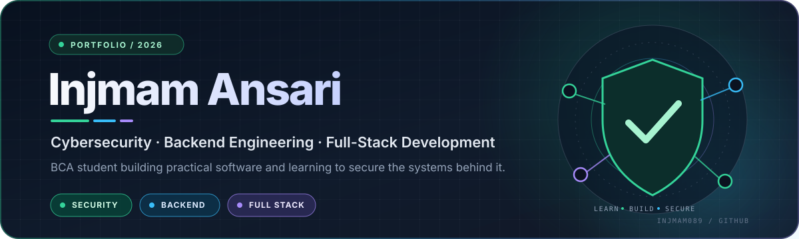
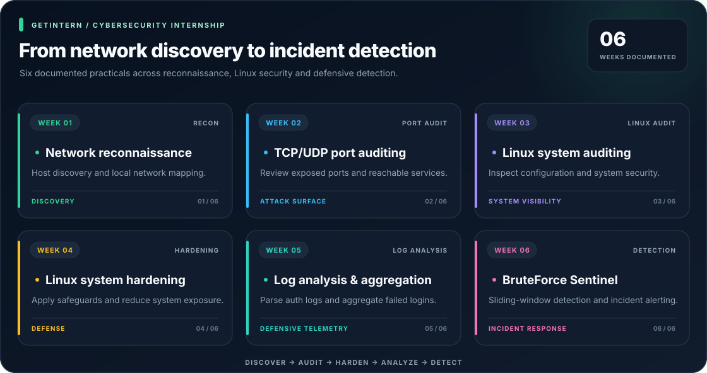
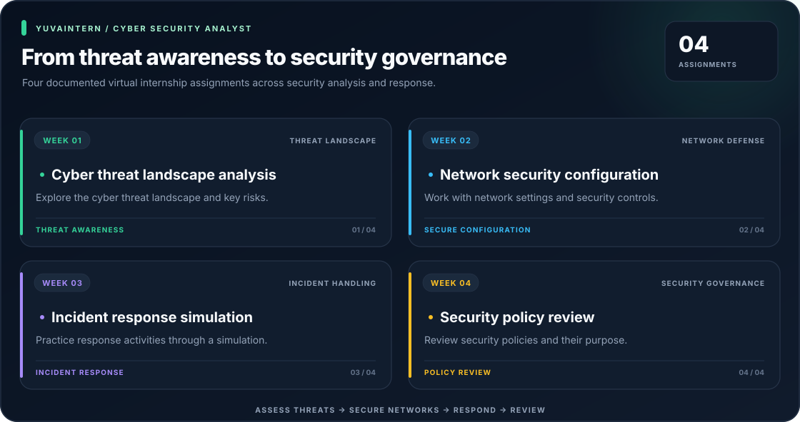
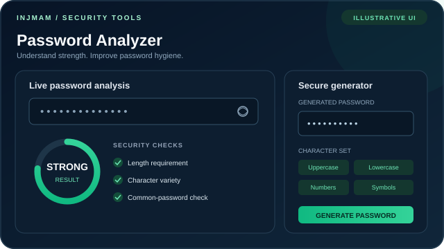
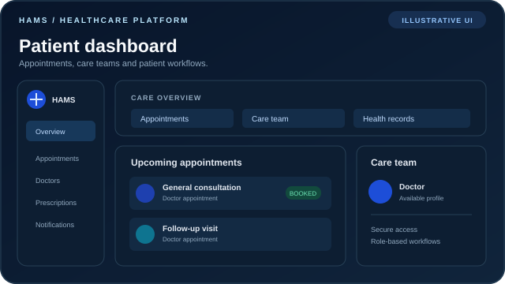
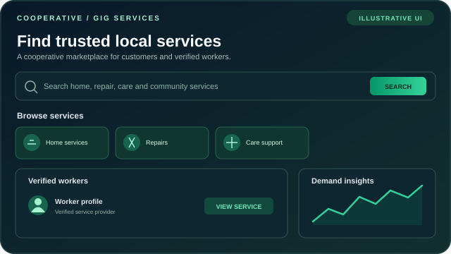
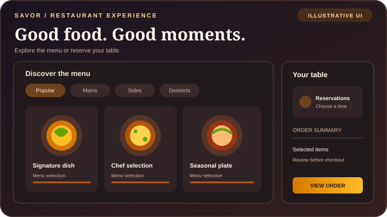
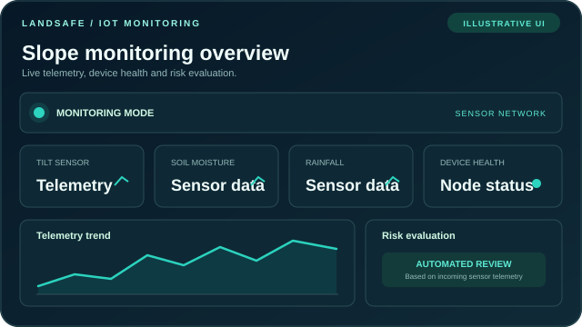
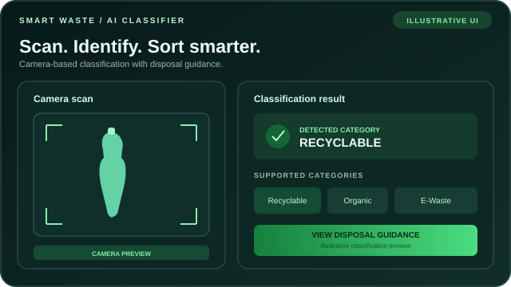

 

  <strong>Cybersecurity</strong> &nbsp;·&nbsp; <strong>Backend Engineering</strong> &nbsp;·&nbsp; <strong>Full-Stack Development</strong>

  
  
  

  
  
  

---

## 👋 About me

I'm **Injmam Ansari**, a BCA student at Integral University, cybersecurity intern, and full-stack/backend developer.

I enjoy understanding how systems work, exploring how they can fail, and applying that knowledge to build useful, reliable, and more secure software.

My work sits at the intersection of **security, backend engineering, and practical product development** — from network-auditing labs to full-stack applications.

## 🎯 What I focus on

| Area | Current toolkit |
|---|---|
| 🛡️ **Cybersecurity** | Nmap, network reconnaissance, TCP/UDP port auditing, Linux auditing and system hardening |
| ☕ **Backend engineering** | Java 17, Spring Boot 3, Spring Security, REST APIs |
| 💻 **Application development** | Python, C++, JavaScript, TypeScript, React, Next.js |
| 🗄️ **Data & persistence** | PostgreSQL, MySQL, MongoDB, Prisma |

**Current direction**

- Build practical full-stack applications with clear architecture.
- Strengthen cybersecurity fundamentals through hands-on labs.
- Improve secure API development, testing, and deployment.
- Explore cloud computing and DevSecOps.

`Understand → Build → Test → Secure → Improve`

---

## 🛡️ Experience & cybersecurity journey

### GetIntern.in · Cybersecurity Intern

October 2026 – Present · Practical 8-week track · 6 practicals documented

A hands-on progression from network discovery and Linux security to defensive telemetry, authentication analysis, and automated incident detection.

<picture>
  <source media="(prefers-color-scheme: dark)" srcset="https://raw.githubusercontent.com/injmam089/injmam089/7b9b1c5ea7bbe4940983827942369bb85152e244/assets/getintern-journey-dark.svg">
  <source media="(prefers-color-scheme: light)" srcset="https://raw.githubusercontent.com/injmam089/injmam089/7b9b1c5ea7bbe4940983827942369bb85152e244/assets/getintern-journey-light.svg">
  
</picture>

  <strong>WEEKLY PRACTICAL EVIDENCE</strong> · Open each repository to explore the work

  
  
  
   
  
  
  

### YuvaIntern · Cyber Security Analyst — Online Virtual Intern

04 October 2026 – 04 November 2026 · 4 assignments documented

Virtual internship assignments covering cyber threat landscape analysis, network security configuration, incident response simulation, and security policy review.

<picture>
  <source media="(prefers-color-scheme: dark)" srcset="https://raw.githubusercontent.com/injmam089/injmam089/f17abd55c1c32c0044981f0bd9d999a3251cdb89/assets/yuva-intern-journey-dark.svg">
  <source media="(prefers-color-scheme: light)" srcset="https://raw.githubusercontent.com/injmam089/injmam089/f17abd55c1c32c0044981f0bd9d999a3251cdb89/assets/yuva-intern-journey-light.svg">
  
</picture>

  <strong>WEEKLY ASSIGNMENT EVIDENCE</strong> · Open each repository to explore the work

  
  
   
  
  

---

## 🚀 Featured projects

A curated selection of application, backend, IoT, and security-focused work. Each project includes a compact interface preview, technology stack, source repository, and live demo where available.

  PROJECT GALLERY · SIX FEATURED BUILDS · PREVIEW ARTWORK IS ILLUSTRATIVE, NOT A CAPTURE OF THE LIVE APPLICATION

<table width="100%" border="1" bordercolor="#263449" cellpadding="12" cellspacing="0">
  <tr>
    <td width="50%" valign="top">
      

      
<strong>SECURITY TOOL · CLIENT-SIDE WEB APP</strong>

      <h3>🔐 Password Strength &amp; Security Analyzer</h3>
      
A privacy-first browser tool for password-strength analysis, common-password checks, contextual recommendations, and secure password generation.

      
<strong>Stack</strong> <code>HTML5</code> · <code>CSS3</code> · <code>JavaScript</code> · <code>Web Crypto API</code>

      

        
        
      

    </td>
    <td width="50%" valign="top">
      

      
<strong>HEALTHCARE · FULL-STACK PLATFORM</strong>

      <h3>🏥 HAMS — Hospital Appointment Management System</h3>
      
A healthcare platform with secure authentication, role-based access, appointment workflows, and consultation and prescription management.

      
<strong>Stack</strong> <code>Java 17</code> · <code>Spring Boot</code> · <code>Spring Security</code> · <code>PostgreSQL</code> · <code>JWT</code> · <code>Docker</code>

      

        
        
      

    </td>
  </tr>
  <tr>
    <td width="50%" valign="top">
      

      
<strong>MARKETPLACE · SMART INDIA HACKATHON 26089</strong>

      <h3>🤝 Cooperative Gig Services Platform — SIH 26089</h3>
      
A cooperative marketplace connecting customers with verified workers, supporting service booking, worker management, and AI-assisted demand forecasting.

      
<strong>Stack</strong> <code>Java</code> · <code>Spring Boot</code> · <code>MySQL</code> · <code>FastAPI</code> · <code>Flutter</code> · <code>Docker</code>

      

        
        
      

    </td>
    <td width="50%" valign="top">
      

      
<strong>FOOD &amp; HOSPITALITY · FULL-STACK WEB APP</strong>

      <h3>🍽️ SAVOR — Restaurant Ordering Platform</h3>
      
A full-stack restaurant platform with online ordering, table reservations, authentication, admin management, and a responsive user interface.

      
<strong>Stack</strong> <code>Next.js</code> · <code>TypeScript</code> · <code>PostgreSQL</code> · <code>Prisma</code> · <code>NextAuth</code>

      

        
        
      

    </td>
  </tr>
  <tr>
    <td width="50%" valign="top">
      

      
<strong>IOT · VISHWAKARMA 2026</strong>

      <h3>🌍 LANDSAFE — Vishwakarma 2026</h3>
      
An IoT landslide-monitoring prototype with real-time sensor telemetry, automated risk evaluation, device-health monitoring, and emergency alerts.

      
<strong>Stack</strong> <code>Java</code> · <code>Spring Boot</code> · <code>PostgreSQL</code> · <code>STOMP WebSocket</code> · <code>React</code> · <code>TypeScript</code> · <code>Docker</code>

      

        
        
      

    </td>
    <td width="50%" valign="top">
      

      
<strong>AI · PROGRESSIVE WEB APP</strong>

      <h3>♻️ Smart Waste Classifier</h3>
      
A camera-based Progressive Web App that classifies recyclable, organic, and e-waste, then provides category-specific disposal guidance.

      
<strong>Stack</strong> <code>HTML5</code> · <code>CSS3</code> · <code>JavaScript</code> · <code>Teachable Machine</code> · <code>PWA</code>

      

        
        
      

    </td>
  </tr>
</table>

<strong>More projects — UniPortal, SAHAYAK, NovaMart and CyberTorque 2D</strong>

| Project | What it is | Links |
|---|---|---|
| **UniPortal** | Student management portal for academic records, attendance, schedules, results, and student workflows. | [Repository](https://github.com/injmam089/UniPortal) · [Live demo](https://uniportal-7vas.onrender.com/) |
| **SAHAYAK — Smart Assistive Stick** | Assistive technology platform combining an ESP32 device, Flutter mobile app, and Spring Boot backend for hazard alerts and caregiver connectivity. | [Repository](https://github.com/injmam089/SAHAYAK-Smart-Assistive-Stick) |
| **NovaMart — E-Commerce Website** | React storefront with product search, filtering, wishlist, cart, coupons, and checkout flows. | [Repository](https://github.com/injmam089/Mart-E-Commerce-Website) |
| **CyberTorque 2D** | C++ top-down arcade racing game with vehicle physics, AI traffic, drifting, procedural audio, and save data. | [Repository](https://github.com/injmam089/CyberTorque-2D) |

  Preview artwork is illustrative and is not a screenshot of the live application. Project repositories and demos provide the actual implementation.

  Some live demos use free hosting and may take a little time to wake up on the first visit.

---

## 🧰 Technology

### Cybersecurity

### Programming languages

<picture>
  <source media="(prefers-color-scheme: light)" srcset="https://skillicons.dev/icons?i=java,py,cpp,js,ts,bash&theme=light">
  
</picture>

### Backend & APIs

<picture>
  <source media="(prefers-color-scheme: light)" srcset="https://skillicons.dev/icons?i=spring,fastapi,maven&theme=light">
  
</picture>

### Frontend & mobile

<picture>
  <source media="(prefers-color-scheme: light)" srcset="https://skillicons.dev/icons?i=react,nextjs,html,css,flutter&theme=light">
  
</picture>

### Databases & developer tools

<picture>
  <source media="(prefers-color-scheme: light)" srcset="https://skillicons.dev/icons?i=postgres,mysql,mongodb,prisma,docker,git,github,linux,postman&theme=light&perline=9">
  
</picture>

### AI / Machine Learning

### Currently learning

---

## 📊 GitHub analytics

  Live profile metrics · all-time commit count · contribution streak

  

<table align="center">
  <tr>
    <td width="50%" valign="top" align="center">
      
    </td>
    <td width="50%" valign="top" align="center">
      
    </td>
  </tr>
</table>

  Streaks track consecutive contribution days (commits, pull requests, and issues), not commit-only days. New activity may take time to appear. Enable <strong>Private contributions</strong> on your GitHub profile if you want eligible private activity reflected in the contribution graph.

## 🐍 Contribution activity

  Contribution trail · automatically generated with GitHub Actions · light and dark theme support

<picture>
  <source media="(prefers-color-scheme: dark)" srcset="https://raw.githubusercontent.com/injmam089/injmam089/output/github-contribution-grid-snake-dark.svg">
  <source media="(prefers-color-scheme: light)" srcset="https://raw.githubusercontent.com/injmam089/injmam089/output/github-contribution-grid-snake.svg">
  
</picture>

---

## 🤝 Let's connect

  <strong>Have an idea, opportunity, or project in mind?</strong> 
  I'm open to internships, collaborations, and meaningful software or cybersecurity work.

  

<strong>Building. Learning. Securing.</strong>

 

Thanks for visiting my profile · © 2026 Injmam Ansari

