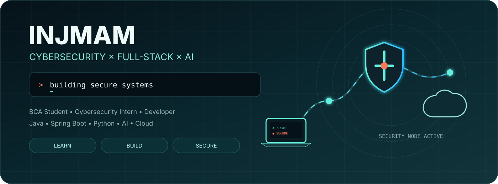
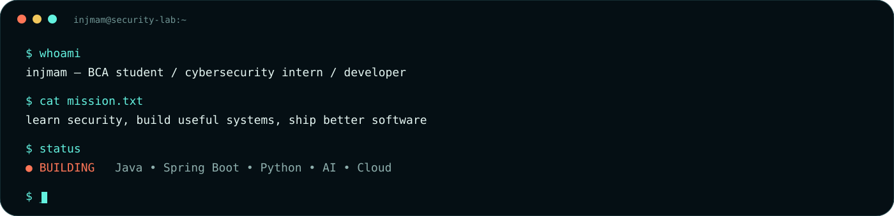
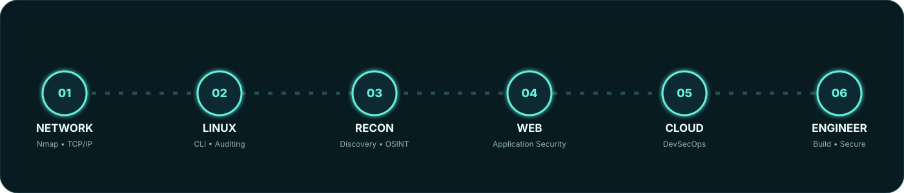

<div align="center">



<br><br>

**🔐 CYBERSECURITY INTERN · 💻 FULL-STACK DEVELOPER · 🤖 AI BUILDER**

`Java` · `Spring Boot` · `Python` · `Linux` · `Network Security` · `Cloud`

<br>

<a href="https://github.com/injmam089"></a>
<a href="https://github.com/injmam089?tab=repositories"></a>
<a href="https://www.linkedin.com/in/injmam089/"></a>

</div>

---

## 🧑‍💻 About Me

I'm **Injmam**, a BCA student and cybersecurity intern focused on building practical software and developing hands-on security skills.

My interests sit at the intersection of:

**🔐 Cybersecurity · 💻 Full-Stack Development · 🤖 AI · ☁️ Cloud**

```text
LEARN → BUILD → TEST → BREAK → DEBUG → SECURE → SHIP
```

I prefer practical learning: build something, understand how it works, test its weaknesses, and improve it.

---

## 🖥️ Terminal

<p align="center">

</p>

---

## 🔐 Cybersecurity Journey

<p align="center">

</p>

## 🛡️ Cybersecurity Experience

### GetIntern — Cybersecurity Internship

| Week | Practical Work | Repository |
|:---:|---|:---:|
| `01` | Network Reconnaissance | [GitHub](https://github.com/injmam089/week-1-network-recon) |
| `02` | TCP/UDP Port Auditing | [GitHub](https://github.com/injmam089/week-2-port-auditing) |
| `03` | Linux System Auditing | [GitHub](https://github.com/injmam089/week-3-linux-system-auditing) |
| `04` | Linux System Hardening | [GitHub](https://github.com/injmam089/week-4-linux-hardening) |

### Yuva Intern — Cybersecurity Internship

| Week | Practical Work | Repository |
|:---:|---|:---:|
| `01` | Cyber Threat Landscape Analysis | [GitHub](https://github.com/injmam089/week-1-cyber-threat-landscape-analysis) |
| `02` | Network Security Configuration | [GitHub](https://github.com/injmam089/week-2-network-security-configuration) |
| `03` | Incident Response Simulation | [GitHub](https://github.com/injmam089/week-3-incident-response-simulation) |
| `04` | Security Policy Review | [GitHub](https://github.com/injmam089/week-4-security-policy-review) |

> Practical work and supporting evidence are documented in the individual repositories.

---

## 🚀 Selected Projects

| Project | Source Code | Live Demo |
|---|:---:|:---:|
| **Password Strength & Security Analyzer** | [GitHub](https://github.com/injmam089/password-strength-security-analyzer-web) | [Open](https://password-strength-security-analyzer-zeta.vercel.app/) |
| **HAMS — Hospital Appointment Management System** | [GitHub](https://github.com/injmam089/Hospital-Appointment-Management-System) | [Open](https://hospital-appointment-management-sys-three.vercel.app/) |
| **Cooperative Gig Platform** | [GitHub](https://github.com/injmam089/cooperative-gig-platform) | [Open](https://cooperative-gig-platform.onrender.com/) |
| **UniPortal** | [GitHub](https://github.com/injmam089/UniPortal) | [Open](https://uni-portal-sand.vercel.app/) |
| **Smart Waste Classifier** | [GitHub](https://github.com/injmam089/smart-waste-classifier) | [Open](https://smart-waste-classifier-steel.vercel.app/) |
| **Savor** | [GitHub](https://github.com/injmam089/savor) | [Open](https://savor-lime.vercel.app/) |
| **Vishwakarma 2026** | [GitHub](https://github.com/injmam089/vishwakarma-2026) | [Open](https://vishwakarma-2026.vercel.app/) |
| **Mart — E-Commerce Website** | [GitHub](https://github.com/injmam089/Mart-E-Commerce-Website) | — |
| **SAHAYAK — Smart Assistive Stick** | [GitHub](https://github.com/injmam089/SAHAYAK-Smart-Assistive-Stick) | — |
| **CyberTorque-2D** | [GitHub](https://github.com/injmam089/CyberTorque-2D) | — |

<sub>— Live demo link not provided yet.</sub>

## 📌 Build Snapshot

<div align="center">

| 🔐 Security Repositories | 🧭 Internship Tracks | 🚀 Selected Projects | 🛠️ Main Focus |
|:---:|:---:|:---:|---|
| **8** | **2** | **10** | Cybersecurity · Backend · Web |

</div>

> I value **working proof over a long skill list** — repositories, demos, security exercises and documented implementation details come first.

---

## ⚙️ Technology Arsenal

<p align="center">

</p>

### 🔐 Security
`Nmap` · `Network Recon` · `Port Auditing` · `Linux Auditing` · `Linux Hardening` · `JWT` · `BCrypt` · `RBAC`

### ☕ Backend
`Java` · `Spring Boot` · `REST APIs` · `PostgreSQL` · `MySQL` · `MongoDB`

### 🤖 AI
`Python` · `FastAPI` · `Scikit-Learn` · `Random Forest` · `Teachable Machine`

### ☁️ Tools
`Git` · `GitHub` · `Docker` · `Linux` · `VS Code` · `Postman` · `Vercel`

### ⚡ Current Focus

```text
🛡️ CYBERSECURITY
   Network Security • Linux • System Hardening • Web Security

☕ BACKEND
   Java • Spring Boot • REST APIs • Databases

🤖 AI / AUTOMATION
   Python • FastAPI • Machine Learning

☁️ EXPLORING
   Cloud • DevSecOps • Secure Deployment
```

---

# 📊 GitHub Activity

<div align="center">


<br><br>


</div>

---

# 🐍 Contribution Activity

<div align="center">


</div>

---

# 🎯 2026 Mission

```text
┌─────────────────────────────────────────────────────────┐
│  🔐 CYBERSECURITY                                       │
│     Networking • Linux • Web Security • Cloud          │
│                                                         │
│  💻 SOFTWARE ENGINEERING                                │
│     Java • Spring Boot • APIs • Databases              │
│                                                         │
│  🤖 AI                                                   │
│     Python • ML • AI-powered applications              │
│                                                         │
│  🚀 OPEN SOURCE                                         │
│     Build • Contribute • Learn                          │
└─────────────────────────────────────────────────────────┘
```

---

## 🧠 Engineering Philosophy

> **Don't just learn technology. Build with it.**

**Understand → Build → Break → Secure → Improve**

---

## 🌐 Connect

<div align="center">

<a href="https://github.com/injmam089"></a>
<a href="https://www.linkedin.com/in/injmam089/"></a>
<a href="mailto:injmam553@gmail.com"></a>

<br><br>

**Open to internships, collaborations, security projects and interesting engineering problems.**

</div>

<br>

<div align="center">


### 🔐 BUILD • LEARN • SECURE • REPEAT

⭐ Thanks for visiting my profile!

</div>
