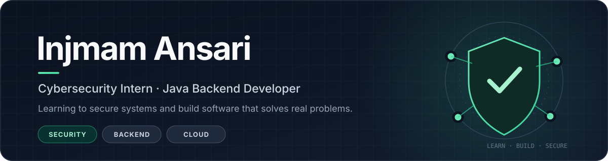

 

---

## About

I'm **Injmam Ansari**, a BCA student at Integral University, cybersecurity intern, and full-stack/backend developer.

I enjoy understanding how systems work, exploring how they can fail, and applying that knowledge to build useful and more secure software.

- 🛡️ **Security:** Network reconnaissance, TCP/UDP port auditing, Linux system auditing and hardening
- ☕ **Backend:** Java 17, Spring Boot 3, Spring Security and REST APIs
- 💻 **Development:** Python, C++, JavaScript, TypeScript, React and Next.js
- ☁️ **Exploring:** Cloud computing, DevSecOps and secure deployment

`Understand → Build → Test → Secure → Improve`

## Cybersecurity Experience

### GetIntern.in — Cybersecurity Intern
October 2026 – Present · Practical 8-week track

Hands-on work covering local network reconnaissance and host discovery, TCP/UDP port auditing with Nmap, Linux system auditing and system hardening.

| Week | Practical work | Repository |
|:---:|---|---|
| 01 | Network reconnaissance & host discovery | [Week 1](https://github.com/injmam089/week-1-network-recon) |
| 02 | TCP/UDP port auditing | [Week 2](https://github.com/injmam089/week-2-port-auditing) |
| 03 | Linux system auditing | [Week 3](https://github.com/injmam089/week-3-linux-system-auditing) |
| 04 | Linux system hardening | [Week 4](https://github.com/injmam089/week-4-linux-hardening) |

### YuvaIntern — Cyber Security Analyst (Online Virtual Intern)
04 October 2026 – 04 November 2026

Virtual internship assignments covering cyber threat landscape analysis, network security configuration, incident response simulation and security policy review.

| Week | Assignment | Repository |
|:---:|---|---|
| 01 | Cyber threat landscape analysis | [Week 1](https://github.com/injmam089/week-1-cyber-threat-landscape-analysis) |
| 02 | Network security configuration | [Week 2](https://github.com/injmam089/week-2-network-security-configuration) |
| 03 | Incident response simulation | [Week 3](https://github.com/injmam089/week-3-incident-response-simulation) |
| 04 | Security policy review | [Week 4](https://github.com/injmam089/week-4-security-policy-review) |

## Featured Projects

<table>
<tr>
<td width="50%" valign="top">

### 🔐 Password Strength & Security Analyzer

A browser-based tool that evaluates password strength, detects common weaknesses and provides improvement recommendations.

**Stack:** HTML · CSS · JavaScript

[Repository](https://github.com/injmam089/password-strength-security-analyzer-web) · [Live demo](https://password-strength-security-analyzer-zeta.vercel.app/)

</td>
<td width="50%" valign="top">

### 🏥 HAMS — Hospital Appointment Management System

A hospital appointment platform with secure authentication, role-based access, appointment workflows, and consultation/prescription management.

**Stack:** Java 17 · Spring Boot · Spring Security · PostgreSQL · JWT · Docker

[Repository](https://github.com/injmam089/Hospital-Appointment-Management-System) · [Live demo](https://hospital-appointment-management-sys-three.vercel.app/)

</td>
</tr>
<tr>
<td width="50%" valign="top">

### 🤝 Cooperative Gig Services Platform — SIH 26089

A cooperative marketplace connecting customers with verified workers, supporting service booking, worker management and AI-assisted demand forecasting.

**Stack:** Java · Spring Boot · MySQL · FastAPI · Flutter · Docker

[Repository](https://github.com/injmam089/cooperative-gig-platform) · [Live demo](https://cooperative-gig-platform.onrender.com/)

</td>
<td width="50%" valign="top">

### 🍽️ SAVOR — Restaurant Ordering Platform

A full-stack restaurant platform with online ordering, table reservations, authentication, admin management and a responsive user interface.

**Stack:** Next.js · TypeScript · PostgreSQL · Prisma · NextAuth

[Repository](https://github.com/injmam089/savor) · [Live demo](https://savor-lime.vercel.app/)

</td>
</tr>
<tr>
<td width="50%" valign="top">

### 🌍 LANDSAFE — Vishwakarma 2026

An IoT landslide-monitoring prototype with real-time sensor telemetry, automated risk evaluation, device-health monitoring and emergency alerts.

**Stack:** Java · Spring Boot · PostgreSQL · STOMP WebSocket · React · TypeScript · Docker

[Repository](https://github.com/injmam089/vishwakarma-2026) · [Live demo](https://vishwakarma-2026.vercel.app/)

</td>
<td width="50%" valign="top">

### ♻️ Smart Waste Classifier

A camera-based Progressive Web App that classifies recyclable, organic and e-waste, then provides category-specific disposal guidance.

**Stack:** HTML5 · CSS3 · JavaScript · Teachable Machine · PWA

[Repository](https://github.com/injmam089/smart-waste-classifier) · [Live demo](https://smart-waste-classifier-steel.vercel.app/)

</td>
</tr>
</table>

<b>More projects</b>

| Project | What it is | Links |
|---|---|---|
| **UniPortal** | Student management portal for academic records, attendance, schedules, results and student workflows. | [Repository](https://github.com/injmam089/UniPortal) · [Live demo](https://uniportal-7vas.onrender.com/) |
| **SAHAYAK — Smart Assistive Stick** | Assistive technology platform combining an ESP32 device, Flutter mobile app and Spring Boot backend for hazard alerts and caregiver connectivity. | [Repository](https://github.com/injmam089/SAHAYAK-Smart-Assistive-Stick) |
| **NovaMart — E-Commerce Website** | React storefront with product search, filtering, wishlist, cart, coupons and checkout flows. | [Repository](https://github.com/injmam089/Mart-E-Commerce-Website) |
| **CyberTorque 2D** | C++ top-down arcade racing game with vehicle physics, AI traffic, drifting, procedural audio and save data. | [Repository](https://github.com/injmam089/CyberTorque-2D) |

## Technology

**Cybersecurity**

**Programming languages**

<picture>
  <source media="(prefers-color-scheme: light)" srcset="https://skillicons.dev/icons?i=java,py,cpp,js,ts,bash&theme=light">
  
</picture>

**Backend & APIs**

<picture>
  <source media="(prefers-color-scheme: light)" srcset="https://skillicons.dev/icons?i=spring,fastapi,maven&theme=light">
  
</picture>

**Frontend**

<picture>
  <source media="(prefers-color-scheme: light)" srcset="https://skillicons.dev/icons?i=react,nextjs,html,css,flutter&theme=light">
  
</picture>

**Databases & tools**

<picture>
  <source media="(prefers-color-scheme: light)" srcset="https://skillicons.dev/icons?i=postgres,mysql,mongodb,prisma,docker,git,github,linux,postman&theme=light&perline=7">
  
</picture>

**AI / Machine Learning**

**Currently learning**

## Contribution Activity

<picture>
  <source media="(prefers-color-scheme: dark)" srcset="https://raw.githubusercontent.com/injmam089/injmam089/output/github-contribution-grid-snake-dark.svg">
  <source media="(prefers-color-scheme: light)" srcset="https://raw.githubusercontent.com/injmam089/injmam089/output/github-contribution-grid-snake.svg">
  
</picture>

## Connect

I'm open to learning opportunities, internships, collaborations and meaningful software or security projects.

<a href="https://www.linkedin.com/in/injmam089/">LinkedIn</a> · <a href="mailto:injmam553@gmail.com">Email</a> · <a href="https://github.com/injmam089">GitHub</a>

Some live demos use free hosting and may take a little time to wake up on the first visit.
